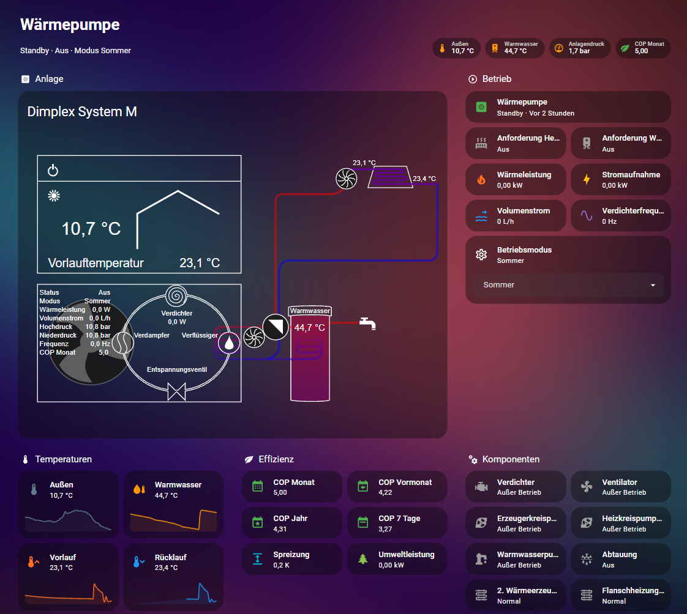
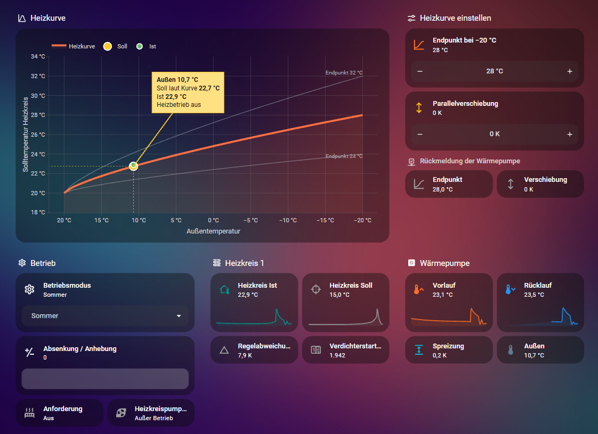
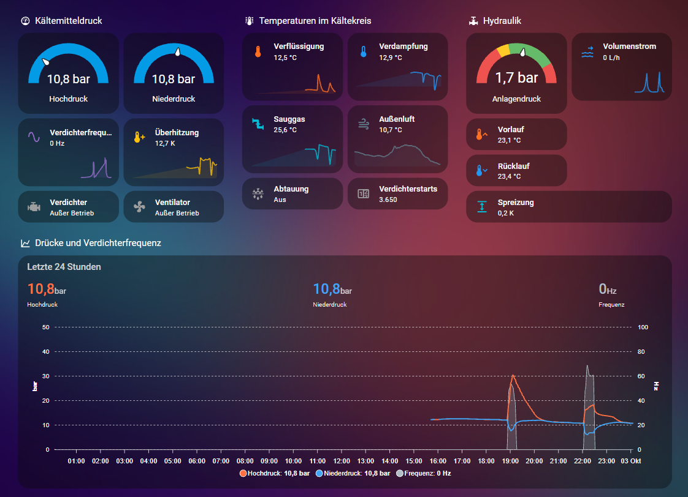
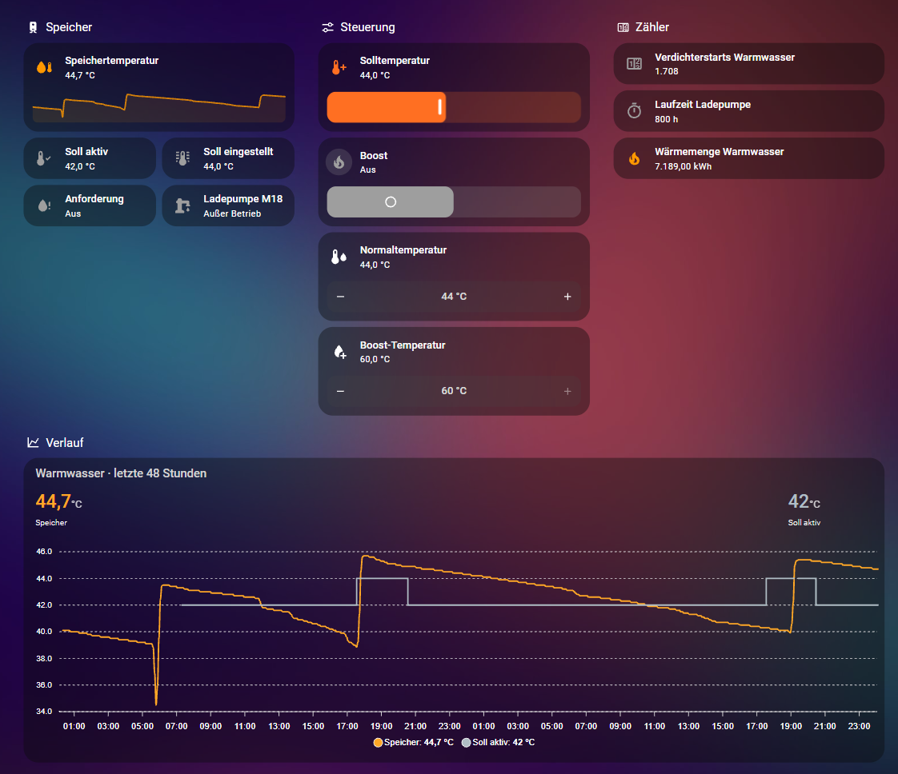
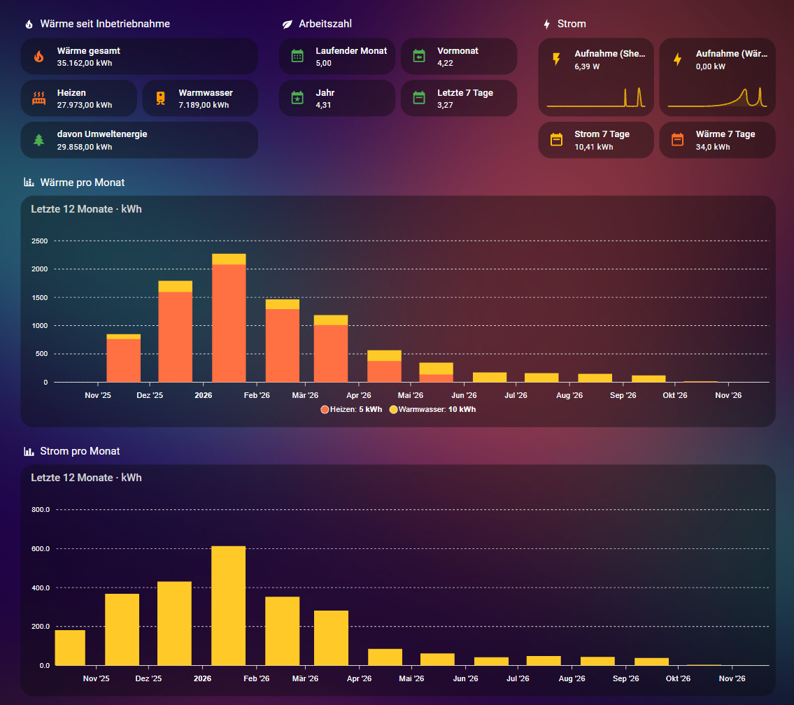
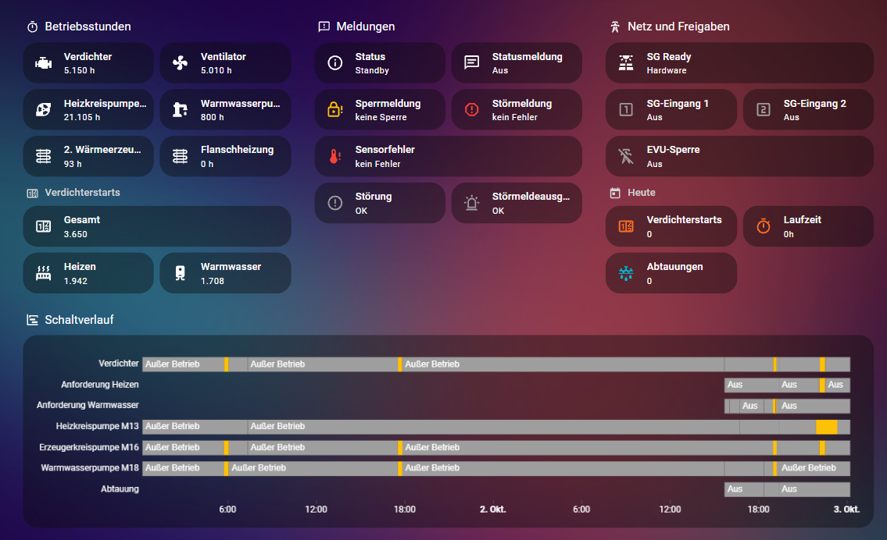
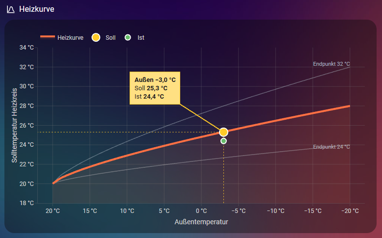

# Dimplex System M in Home Assistant

> **English summary:** Home Assistant configuration for a Dimplex System M air/water heat pump
> connected via Modbus TCP through the NWPM Touch extension module: Modbus sensors including several registers that
> are missing from the official data point lists (refrigerant pressures, system pressure, flow
> rate, inverter frequency), template sensors, write access for operating mode, hot water
> setpoint and heating curve, a six-view dashboard and a live heating-curve chart.
> Tested on exactly one unit (software M3.15). Documentation is in German.

Home-Assistant-Konfiguration für eine Luft/Wasser-Wärmepumpe **Dimplex System M**, angebunden
über Modbus TCP mit der **NWPM Touch-Erweiterung**. Das Projekt ist an einer einzelnen Anlage entstanden und wird hier so
veröffentlicht, wie es dort läuft. Wie die Register gefunden und die Teile gebaut wurden, steht
Schritt für Schritt in [`docs/vorgehen.md`](docs/vorgehen.md).

**Kein offizielles Dimplex-Projekt.** Nutzung auf eigene Verantwortung, siehe
[Sicherheitshinweis](#sicherheitshinweis).



Weitere Ansichten: [Bilder](#bilder)

## Was enthalten ist

- **Modbus-Sensoren** für Temperaturen, Betriebszustände, Zähler, Wärmemengen und Leistungen.
  Dazu Datenpunkte, die in den offiziellen Dimplex-Listen fehlen: Hoch- und Niederdruck im
  Kältekreis, Heizwasser-Anlagendruck, Volumenstrom, Inverterfrequenz.
  → [`packages/dimplex_modbus.yaml`](packages/dimplex_modbus.yaml),
  [`docs/modbus-register.md`](docs/modbus-register.md)
- **Auswertung und Steuerung**: Wärmemengen aus den dreiteiligen Zählerregistern, COP, Status im
  Klartext, Betriebsmodus, Warmwasser-Sollwert mit Boost, Heizkurve (Endpunkt und
  Parallelverschiebung) mit Rücklesekontrolle, Störmeldung aufs Handy.
  → [`packages/dimplex_steuerung.yaml`](packages/dimplex_steuerung.yaml)
- **Helfer und Überwachung**: Klartext zu Sperr-, Stör- und Sensorfehlercodes, Verdichterstarts
  und Laufzeit pro Tag, 7-Tage-Arbeitszahl, Warnung bei falschem Anlagendruck und bei Takten.
  → [`packages/dimplex_helfer.yaml`](packages/dimplex_helfer.yaml)
- **Dashboard** mit sechs Ansichten (Übersicht, Kältekreis, Warmwasser, Heizkreis, Energie,
  Wartung). → [`dashboards/heizung.yaml`](dashboards/heizung.yaml)
- **Heizkurven-Diagramm**, das die eingestellte Kurve zeichnet und den aktuellen Soll- und
  Istwert einträgt. → [`dashboards/karten/heizkurve.yaml`](dashboards/karten/heizkurve.yaml),
  [`docs/heizkurve.md`](docs/heizkurve.md)
- **Scan-Skript**, mit dem die undokumentierten Register gefunden wurden. Es kann nur lesen.
  → [`tools/dimplex_scan.py`](tools/dimplex_scan.py)

## Getestet mit

| | |
|---|---|
| Wärmepumpe | Dimplex System M (M Flex, reversibel), Fußbodenheizung, ein Heizkreis, Warmwasser |
| Regler | WPM (pCOoem M), Software M3.15a04, Kältekreismodul uPC2 S |
| Anbindung | NWPM Touch-Erweiterung (Dimplex-Artikel 378800), Modbus TCP, Port 502, Unit 1 |
| Home Assistant | Core 2026.9, Home Assistant OS |
| Karten | plotly-graph-card 3.3.5, apexcharts-card 2.2.3, lovelace-heat-pump-card 0.9.2, card-mod 4.2.1 |

Andere Dimplex-Geräte und andere Softwarestände des Wärmepumpenmanagers (H, J, L) können
abweichende Register haben. Ungeprüft übernehmen sollte man nichts, vor allem keine
Schreibzugriffe.

## Voraussetzung: NWPM Touch-Erweiterung mit Modbus TCP

Das Projekt ist für Anlagen geschrieben, die über die **NWPM Touch-Erweiterung** im Netzwerk
hängen. Das ist das Netzwerkmodul, das im Wärmepumpenmanager im Steckplatz „Serial Card/BMS
Card" sitzt. Modbus TCP ist dort nicht von selbst aktiv, es muss einmal in der Weboberfläche des
Moduls freigegeben werden:

1. IP-Adresse des Moduls am Display unter „Analytics" ablesen.
2. Im Browser `https://<IP-Adresse>/` öffnen. Das `https://` muss davorstehen. Die Warnung „Dies
   ist keine sichere Verbindung" über „Erweitert" → „Weiter zu … (unsicher)" bestätigen.
3. Anmelden mit Benutzer `admin`. Das Passwort zeigt das Display unter Analytics → Hard- und
   Software → Netzwerk → Gateway Zugang.
4. In der Weboberfläche „Einstellungen" öffnen und in der Kachel „Gateway Zugang" die
   Netzwerkdienste freigeben.
5. Neu starten und danach prüfen, ob die Freigabe noch gesetzt ist.

Danach ist Modbus TCP auf Port 502 erreichbar. An der Ursprungsanlage laufen Modbus TCP und die
Dimplex Home App gleichzeitig; die App muss dafür nicht abgeschaltet werden.

Die Schritte stammen aus dem Dimplex-Wiki:
[Modbus TCP Anbindung](https://dimplex.atlassian.net/wiki/spaces/DW/pages/3303571457) und
[NWPM Touch-Erweiterung](https://dimplex.atlassian.net/wiki/spaces/DW/pages/3017506817). Dort
stehen auch die Mindeststände: WPM-Software ab M3.3, Firmware ab A2.1.0 – B2.1.0.

Mit denselben Zugangsdaten lässt sich die Verlaufsdatenbank herunterladen, aus der die
undokumentierten Register stammen (siehe [`docs/vorgehen.md`](docs/vorgehen.md)).

## Bilder

Aufnahmen der Ursprungsanlage vom 3. Oktober 2026, Sommerbetrieb, Wärmepumpe im Standby.

| Heizkreis mit Heizkurve | Kältekreis |
|---|---|
|  |  |
| **Warmwasser** | **Energie** |
|  |  |
| **Wartung** | **Heizkurve im Heizbetrieb (Beispiel)** |
|  |  |

Das Beispielbild der Heizkurve zeigt simulierte Werte (außen −3 °C), weil die Anlage zum
Zeitpunkt der Aufnahmen nicht heizte. Alle anderen Bilder zeigen echte Werte.

## Einbau in Kurzform

1. Modbus TCP an der NWPM Touch-Erweiterung freigeben (siehe oben).
2. Pakete in der `configuration.yaml` einschalten.
3. Die drei Dateien aus `packages/` nach `/config/packages/` kopieren.
4. Adresse der Wärmepumpe in die `secrets.yaml` eintragen (Vorlage:
   [`secrets.yaml.example`](secrets.yaml.example)).
5. Alle Stellen mit `# TODO: Anpassen` durchgehen.
6. Konfiguration prüfen, Home Assistant neu starten, Werte mit dem Display vergleichen.
7. Karten über HACS installieren und das Dashboard einfügen.

Ausführlich: [`docs/installation.md`](docs/installation.md)

## Was alles angelegt wird

| Art | Anzahl | Wo |
|---|---|---|
| Modbus-Sensoren | 50 | `dimplex_modbus.yaml` |
| Modbus-Binärsensoren | 15 | `dimplex_modbus.yaml` |
| Template-Sensoren | 17 + 5 | `dimplex_steuerung.yaml`, `dimplex_helfer.yaml` |
| Template-Binärsensoren | 2 | `dimplex_steuerung.yaml` |
| Tages- und 7-Tage-Sensoren, Stromzähler | 6 | `dimplex_helfer.yaml` |
| Bedien-Helfer (`input_number`, `input_select`, `input_boolean`) | 2 + 6 | `dimplex_steuerung.yaml`, `dimplex_helfer.yaml` |
| Skripte | 2 | `dimplex_steuerung.yaml` |
| Automationen | 13 + 2 | `dimplex_steuerung.yaml`, `dimplex_helfer.yaml` |
| Dashboard-Ansichten | 6 | `dashboards/heizung.yaml` |

Alle Entitäten beginnen mit `dimplex_wp_` oder `dimplex_`, bis auf die Strommessung
(`heizung_stormverbrauch`, `heizungverbrauch`, `waermepumpe_leistung`) und die
7-Tage-Arbeitszahl (`wp_cop`, `wp_strom_7_tage`, `wp_warme_7_tage`).

## Platzhalter

Persönliche Daten sind durch Platzhalter ersetzt. Vor dem Einsatz ausfüllen:

| Platzhalter | Wo | Was hinein muss |
|---|---|---|
| `!secret dimplex_modbus_host` | `packages/dimplex_modbus.yaml` | IP-Adresse der NWPM Touch-Erweiterung, als Eintrag in der eigenen `secrets.yaml` |
| `notify.mobile_app_dein_geraet` | `dimplex_steuerung.yaml`, `dimplex_helfer.yaml` | eigener Benachrichtigungsdienst, z. B. `notify.mobile_app_<gerätename>` |
| `sensor.shellyem3_xxxxxxxxxxxx_channel_a_power` (und `_b_`, `_c_`) | `dimplex_steuerung.yaml`, `dashboards/heizung.yaml` | eigene Leistungssensoren der Strommessung an der Wärmepumpe, je Phase |

Ohne eigene Strommessung entfallen die Sensoren `Heizung_Stormverbrauch`,
`Dimplex_WP COP_Gemessen`, `Heizungverbrauch`, `WP Strom 7 Tage` und `WP COP` sowie die
zugehörigen Kacheln im Dashboard. Die Werte aus den Registern der Wärmepumpe bleiben davon
unberührt.

## Abhängigkeiten

Nur für das Dashboard, alle über HACS:

- [plotly-graph-card](https://github.com/dbuezas/lovelace-plotly-graph-card)
- [apexcharts-card](https://github.com/RomRider/apexcharts-card)
- [lovelace-heat-pump-card](https://github.com/ManfredTremmel/lovelace-heat-pump-card)
- [card-mod](https://github.com/thomasloven/lovelace-card-mod)
- Theme `ios-dark-mode-blue-red` (optional, sonst die `theme:`-Zeilen entfernen)

Die Pakete selbst brauchen nur die eingebauten Integrationen von Home Assistant.

## Was geprüft ist und was nicht

**An der Anlage bestätigt**

- Adressen und Skalierung der Datenpunkte, die in `docs/modbus-register.md` als „bestätigt"
  markiert sind (Abgleich mit Display, App und Verlaufsdatenbank).
- Schreiben von Betriebsmodus, Warmwasser-Sollwert, Heizkurven-Endpunkt und
  Parallelverschiebung, jeweils mit Rücklesen.
- Heizkurven-Formel bei rund 12 °C Außentemperatur: Abweichung 0,1 bis 0,4 K.

**Nicht oder nur teilweise geprüft**

- Heizkurven-Formel im Frost: Sie stammt aus Statistikdaten eines Winters, der direkte Vergleich
  bei tiefen Temperaturen steht aus.
- Klartext-Tabellen der Meldecodes: aus Dimplex-Unterlagen übernommen, einzeln bestätigt ist nur
  Sperrcode 9.
- Die Warnungen für Anlagendruck und Takten haben noch nie ausgelöst.
- `packages/dimplex_helfer.yaml` bildet Helfer nach, die in der Ursprungsanlage über die
  Oberfläche angelegt sind. Als YAML lief die Datei noch nicht im Dauerbetrieb.
- Smart-Grid-Register 7663: nur gelesen, nie geschrieben.
- Kühlbetrieb.

Mehr dazu: [`docs/bekannte-grenzen.md`](docs/bekannte-grenzen.md)

## Sicherheitshinweis

Die Skripte und Automationen schreiben Einstellungen in die Wärmepumpe (Register 5015, 5036,
5038, 5047, 5065). Ein falscher Wert im falschen Register kann die Anlage verstellen. Deshalb:

- Zuerst nur `dimplex_modbus.yaml` einbauen und die gelesenen Werte mit dem Display vergleichen.
- `dimplex_steuerung.yaml` erst danach dazunehmen und jeden Schreibweg einzeln testen.
- Die Grenzen der Helfer (`min`/`max`) passend zur eigenen Anlage setzen.

Das Scan-Skript in `tools/` enthält keine Schreibfunktionen.

## Aufbau des Repositorys

```
packages/
  dimplex_modbus.yaml       Modbus-Hub und Sensoren
  dimplex_steuerung.yaml    Template-Sensoren, Skripte, Automationen
  dimplex_helfer.yaml       Helfer, Klartext, Tageswerte, Warnungen
dashboards/
  heizung.yaml              komplettes Dashboard
  karten/heizkurve.yaml     Heizkurven-Diagramm als einzelne Karte
docs/
  installation.md           Einbau Schritt für Schritt
  vorgehen.md               wie die Register gefunden und die Teile gebaut wurden
  modbus-register.md        Adressregel und undokumentierte Register
  heizkurve.md              Formel, Messpunkte, Diagramm
  bekannte-grenzen.md       Einschränkungen und Fallstricke
  bilder/                   Aufnahmen des Dashboards
tools/
  dimplex_scan.py           Register-Scan (nur lesend)
secrets.yaml.example        Vorlage für die eigene secrets.yaml
```

## Entstehung

Die Konfiguration ist im Dialog mit Claude (KI-Assistent von Anthropic) entstanden, der über das
Add-on ha-mcp direkt an der laufenden Anlage lesen und testen konnte. Details in
[`docs/vorgehen.md`](docs/vorgehen.md).

## Lizenz

MIT, siehe [`LICENSE`](LICENSE).

„Dimplex" ist eine Marke der Glen Dimplex Gruppe. Dieses Projekt steht in keiner Verbindung zum
Hersteller.
