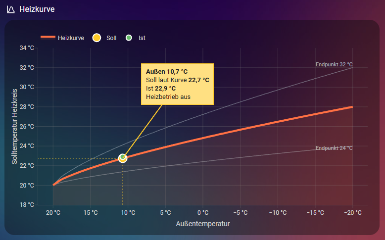

# Heizkurve: Formel, Messpunkte, Diagramm

## Die zwei Einstellwerte

| Einstellung | Register | Bedeutung |
|---|---|---|
| Endpunkt | 5038 | Rücklauf-Solltemperatur bei −20 °C Außentemperatur |
| Parallelverschiebung | 5036 | verschiebt die ganze Kurve um ganze Kelvin nach oben oder unten |

Die Wärmepumpe regelt auf die **Rücklauftemperatur**. Der Sollwert steht in
`sensor.dimplex_wp_temperatur_ruecklauf_soll`, der Istwert in
`sensor.dimplex_wp_temperatur_ruecklauf`.

Im Sommerbetrieb meldet die Wärmepumpe 15 °C als Sollwert. Das bedeutet „Heizen aus".

## Formel

Dimplex veröffentlicht die Kurvenform nicht. Die folgende Näherung ist aus der
Langzeitstatistik eines Winters (Dezember 2025 bis Mai 2026) angepasst:

```
Soll = 20 + (Endpunkt − 20) × ((20 − Außen) / 40) ^ 0,733 + Parallelverschiebung
```

- Fußpunkt: 20 °C Sollwert bei 20 °C Außentemperatur.
- Wärmer als 20 °C außen: Der Klammerwert wird auf 0 begrenzt, die Kurve bleibt bei 20 °C plus
  Parallelverschiebung.
- Im Bereich −8 bis +10 °C trifft die Formel die Statistikwerte auf ±0,15 K. Dabei ist
  angenommen, dass der Endpunkt in diesem Winter durchgehend bei 28 °C stand.

## Vergleich mit der Wärmepumpe

Direkter Test am 2. Oktober 2026 bei rund 12 °C Außentemperatur, also etwas außerhalb des
Bereichs, aus dem die Formel stammt:

| Endpunkt | Parallelverschiebung | Außen | Soll Wärmepumpe | Formel |
|---|---|---|---|---|
| 28 °C | 0 K | 11,9 °C | 22,4 °C | 22,5 °C |
| 31 °C | +6 K | 11,8 °C | 29,2 °C | 29,4 °C |
| 38 °C | +10 K | 11,6 °C | 35,4 °C | 35,7 °C |

Ergebnis: Die Formel liegt hier 0,1 bis 0,4 K zu hoch. Die Parallelverschiebung wirkt genau
1 K je Schritt. Ein direkter Vergleich bei Frost steht noch aus.

## Schreiben der Werte

- Endpunkt: Wert in °C direkt in Register 5038.
- Parallelverschiebung: gewünschte Verschiebung **plus 19** in Register 5036. Der Rohwert läuft
  von 0 bis 38, 19 bedeutet keine Verschiebung.
- Die Automation `dimplex_hk1_heizkurve_schreiben` wartet 3 Sekunden (Entprellung), schreibt,
  liest zurück und meldet, wenn der Wert nicht angekommen ist.
- Die Automation `dimplex_hk1_heizkurve_sync` übernimmt Änderungen, die am Display oder in der
  App gemacht wurden, in die Helfer.
- Die Wärmepumpe rechnet einen geänderten Wert erst nach etwa 1,5 bis 3,5 Minuten in den
  Sollwert ein.

Die Helfer begrenzen den Endpunkt auf 22 bis 40 °C und die Verschiebung auf −10 bis +10 K. Das
passt zu einer Fußbodenheizung. Für Heizkörper die Grenzen in `dimplex_steuerung.yaml` anpassen;
im Diagramm stehen dieselben Grenzen für die Nachbarkurven in der Funktion am Anfang der Karte.

## Das Diagramm

[`dashboards/karten/heizkurve.yaml`](../dashboards/karten/heizkurve.yaml), Karte
`custom:plotly-graph`.

Sommerbetrieb, echte Werte. Der gelbe Punkt sitzt auf der Kurve, weil die Wärmepumpe nicht
heizt:



Heizbetrieb, für die Aufnahme simulierte Werte (außen −3 °C). Der gelbe Punkt ist der Sollwert
der Wärmepumpe, der grüne der Istwert:


- **Orange Linie:** die aktuell eingestellte Heizkurve.
- **Graue Linien:** Nachbarkurven mit Endpunkt ±4 K, als Orientierung beim Verstellen.
- **Gestrichelte Linie:** die Kurve ohne Parallelverschiebung. Erscheint nur, wenn die
  Verschiebung nicht 0 ist.
- **Gelber Punkt „Soll":** im Heizbetrieb der Sollwert der Wärmepumpe, sonst der Wert laut
  Kurve. Sitzt bei der aktuellen Außentemperatur.
- **Grüner Punkt „Ist":** die Isttemperatur. Liegt sie außerhalb der Achse, sitzt sie als
  Dreieck am Rand; der echte Wert steht in der Sprechblase.
- **Grün gepunktete Linie:** der Abstand zwischen Soll und Ist.
- **Sprechblase:** Außentemperatur, Soll und Ist als Zahlen. Weichen Kurve und Sollwert der
  Wärmepumpe um mehr als 0,5 K voneinander ab, kommt die Zeile „laut Kurve" dazu.

Die x-Achse läuft wie in Heizungsunterlagen üblich von warm (links) nach kalt (rechts). Die
Achsen passen sich an Endpunkt und Parallelverschiebung an.

Die gesamte Berechnung steht in der Funktion `fn` des ersten Eintrags der Karte. Wer die Formel
ändern will, ändert dort den Exponenten `P` oder die Funktion `f`.

Hinweis: plotly-graph zeichnet nur in einem sichtbaren Browser-Tab. In einem Hintergrund-Tab
bleibt die Karte leer, bis man hinschaut.
